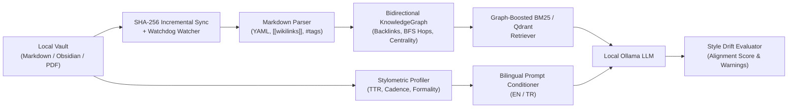

# Personal Omniscience Engine

[](https://github.com/ensibey/personal-omniscience-engine/actions/workflows/ci.yml)


A local, privacy-first **personal knowledge engine** that indexes Markdown/Obsidian vaults and PDFs with **incremental SHA-256 sync**, builds a bidirectional **`[[wikilink]]` knowledge graph** for graph-boosted retrieval, and conditions local LLM responses on a quantitative **stylometric profile** of your own writing.

---

## Architecture



---

## Reproducible Vault & Stylometry Benchmark

Measured on a 10-note Obsidian-style linked vault (`benchmarks/run_benchmark.py`):

```bash
python benchmarks/run_benchmark.py
```

| Evaluation | Metric | Result |
| :--- | :--- | :---: |
| **Plain BM25 (No Graph)** | Recall@3 / MRR (linked notes) | `33.3%` / `0.333` (`0.013 ms`) |
| **Wikilink Graph-Boosted BM25** | Recall@3 / MRR (linked notes) | **`100.0%`** / **`0.639`** (`0.016 ms`) |
| **Style Drift Evaluator** | In-style alignment vs Drifted reply | **`0.929`** vs **`0.230`** (margin `+0.699`) |

---

## Quick Start

### 1. Offline CLI (No Qdrant or Ollama Required)

```bash
python cli.py profile path/to/vault
python cli.py search path/to/vault "vector database HNSW"
python cli.py graph path/to/vault
python cli.py drift path/to/vault "Your candidate response text..."
```

### 2. One-Command Docker Stack

```bash
docker compose up -d
docker build -t omniscience-engine .
```

### 3. Run Tests

```bash
pytest -v tests/
```

---

## License

MIT
